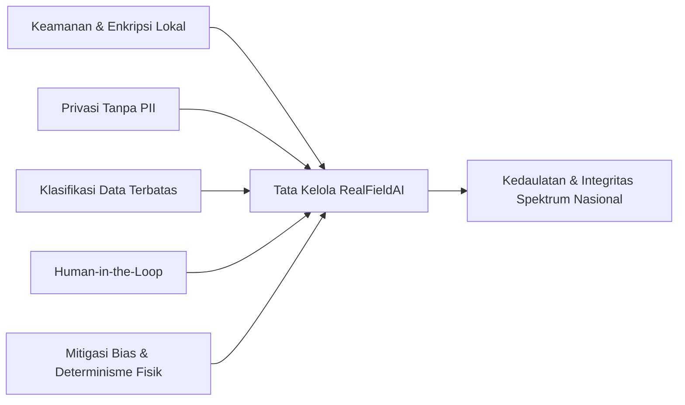

# BERKAS DOKUMEN KARYA INOVASI AI
## AI TALENT FESTIVAL (AITF) BPSDM KEMENTERIAN KOMUNIKASI DAN DIGITAL
---

### IDENTITAS KARYA
* **Nama Karya:** RealFieldAI
* **Kepanjangan:** *Real Measurement-Based Field Artificial Intelligence*
* **Tagline Utama:** *Real Measurements, Intelligent Predictions*
* **Kategori/Tema:** Tata Kelola Penataan Spektrum Frekuensi Radio, Penyiaran Digital DVB-T2, & Infrastruktur Digital Nasional
* **Instansi/Unit Kerja:** Balai Monitor Spektrum Frekuensi Radio / Direktorat Jenderal Penyelenggaraan Pos dan Informatika (DJID) - Kementerian Komunikasi dan Digital (Komdigi)
* **Tautan Repositori GitHub:** [https://github.com/afissutaleal/dvbt2](https://github.com/afissutaleal/dvbt2)
* **Status Purwarupa:** TRL-7 (Telah diuji pada lingkungan operasional riil lapangan Balikpapan & Samarinda, siap pakai sebagai aplikasi desktop mandiri *.exe* dan web dashboard).

---
---

# BAGIAN 1: LAPORAN KARYA
*(Sesuai Ketentuan: Maksimal 5 Halaman Eksekutif Komprehensif)*

## I. PERMASALAHAN (Latar Belakang & Tantangan Riil)

Pasca diselesaikannya program migrasi siaran televisi analog ke digital (*Analog Switch-Off* / ASO) di seluruh Indonesia sesuai amanat UU Cipta Kerja dan Permenkominfo, Kementerian Komunikasi dan Digital memiliki tanggung jawab vital untuk memastikan **kualitas penerimaan siaran televisi digital DVB-T2 memenuhi standar teknis batas minimum penerimaan ($\ge 54{,}0\text{ dB}\mu\text{V/m}$ untuk indoor dan $\ge 45{,}2\text{ dB}\mu\text{V/m}$ untuk outdoor)** serta bebas dari interferensi antar-wilayah layanan.

Namun, di lapangan operasional, Balai Monitor (Balmon) dan pemangku kepentingan penyiaran menghadapi tiga tantangan krusial:

1. **Ketergantungan Ekstrem pada Perangkat Lunak Asing yang Sangat Mahal (*Vendor Lock-in*):**
   Perencanaan dan verifikasi jangkauan selama ini bertumpu pada software simulasi komersial asing (seperti ATDI ICS Telecom atau CHRYSALHE) dengan biaya lisensi tahunan mencapai miliaran rupiah per instansi. Model propagasi teoritis klasik di software tersebut (Okumura-Hata, ITU-R P.1546) sering kali meleset jauh dari kenyataan tropis dan kontur ekstrem perbukitan Indonesia karena tidak dikalibrasi secara adaptif dengan data ukur riil.
2. **Keterbatasan Fisik dan Tingginya Biaya Operasional Pengukuran Lapangan (*Drive-Test*):**
   Metode verifikasi lapangan konvensional mengharuskan mobil unit monitoring melakukan *drive-test* menyusuri ribuan kilometer jalan. Metode ini sangat lambat (membutuhkan waktu berminggu-minggu per wilayah layanan), memakan biaya BBM dan logistik yang tinggi, serta **memiliki kelemahan fatal: mobil ukur hanya bisa melintasi jalan raya beraspal**. Wilayah pemukiman pelosok, pedesaan di balik bukit, dan daerah 3T yang justru paling rentan mengalami *blank spot* tidak dapat dijangkau oleh kendaraan ukur.
3. **Risiko Sengketa Interferensi Lintas Wilayah Layanan:**
   Berdasarkan Masterplan Penyiaran DVB-T2 Indonesia (Permenkominfo No. 6/2019), terdapat 225 Wilayah Layanan dengan 1.113 Titik Uji kepatuhan regulasi (*Compliance Test Points*). Menara pemancar yang memancar melebihi batas kuat medan di titik uji perbatasan wilayah dapat melumpuhkan siaran di wilayah tetangga. Selama ini belum ada platform mandiri nasional yang mampu mengaudit potensi pelanggaran regulasi titik uji tersebut secara otomatis dan cepat.

---

## II. SOLUSI: RealFieldAI

**RealFieldAI** (*Real Measurement-Based Field Artificial Intelligence*) hadir sebagai terobosan platform kecerdasan buatan nasional mandiri yang menjembatani **data empiris riil pengukuran lapangan (*drive-test ground truth*)** dengan pemodelan spasial Machine Learning dan hukum fisika propagasi gelombang elektromagnetik UHF (478 – 694 MHz).

Sistem ini tidak sekadar melakukan interpolasi statistik sederhana, melainkan memproses interaksi fisik antara gelombang radio, daya pemancar empiris, kelengkungan bumi efektif ($k=4/3$), dan profil topografi tanah beresolusi tinggi (SRTM DEM) untuk memprediksi kuat medan sinyal secara presisi hingga ke area-area *blank spot* yang mustahil ditembus mobil ukur.

### Komponen Inti Solusi:
1. **Intelligent Ingestion & Self-Calibrated EIRP:** Penyatuan multiberkas hasil ukur instrumen monitoring (*scanner receiver* R&S, Anritsu, dll) dengan kalkulasi otomatis daya pancar isotropis efektif empiris ($EIRP_{\text{dBm}} = E_{\max} + 20\log_{10}(d) - 44{,}76$).
2. **Terrain Clearance & Radio Horizon Engine:** Rekonstruksi garis pandang (*Line-of-Sight*) 3D sepanjang lintasan gelombang dan kuantifikasi jarak bebas halangan (*clearance* $h_{\text{los}} - h_{\max}$) serta batas horizon radio geometris.
3. **Custom XGBoost Regressor with Bayesian Hyperparameter Tuning (Optuna):** Model Machine Learning terlatih mandiri yang mempelajari koefisien propagasi lokal tanpa memerlukan koneksi cloud API pihak ketiga.
4. **Continuous Telecom Heatmap & Grid Polygon Generator:** Pemetaan resolusi spasial tinggi (100m x 100m) dengan skema warna baku regulasi Komdigi/ITU-R.
5. **DVB-T2 Masterplan Regulatory Audit Engine:** Audit kepatuhan otomatis terhadap 225 Wilayah Layanan dan 1.113 Titik Uji Nasional berbasis koordinat spasial poligon KML resmi.

---

## III. INOVASI & KEBARUAN KARYA

Dibandingkan dengan metode konvensional dan aplikasi pemetaan umum, RealFieldAI memiliki 5 nilai kebaruan (*novelty*) utama:

| Aspek | Metode Konvensional / Software Asing | Inovasi RealFieldAI |
|---|---|---|
| **Basis Pemodelan** | Model teoritis empiris statis luar negeri (Okumura-Hata) yang kaku. | **Hybrid Physics-Guided AI:** Menggabungkan 8 fitur fisik lintasan gelombang dengan algoritma Machine Learning *Extreme Gradient Boosting* (XGBoost). |
| **Keterlibatan Data Riil** | Sering kali mengabaikan data lapangan riil, hanya mengandalkan spesifikasi brosur pemancar. | **Ground-Truth Calibration:** Model belajar langsung dari ribuan titik ukur dinamis lapangan (*drive-test*). |
| **Analisis Kontur Tanah** | Komputasi ray-tracing sangat berat, lambat, dan berbayar mahal. | **Adaptive Sub-Sampling Terrain Clearance:** Komputasi elevasi topografi berkecepatan tinggi dengan deteksi *Strict NLoS Cutoff* seketika. |
| **Pemeriksaan Regulasi** | Dihitung manual satu per satu titik koordinat perbatasan. | **Automated Masterplan Compliance Engine:** Sekali klik, langsung mengaudit status koordinasi di seluruh Titik Uji Wilayah Layanan KML. |
| **Aksesibilitas & Kedaulatan** | Lisensi mahal per workstation, butuh spesifikasi PC workstation kelas atas. | **Zero Vendor Lock-in & Portable:** Dapat dijalankan di laptop standar petugas lapangan tanpa internet (*offline-capable*) dalam format *Standalone Installer .exe*. |

### 8 Fitur Fisik Unggulan Model AI:
1. `frequency_hz`: Frekuensi kerja siaran TV digital UHF (Hz).
2. `eirp_dbm`: Daya pancar efektif empiris terkalibrasi instrumen (dBm).
3. `distance_km`: Jarak geodetik Haversine pemancar-penerima ($d \neq 0$).
4. `azimuth_sin`: Transformasi sinus sudut bearing (mengeliminasi diskontinuitas batas $0^\circ \leftrightarrow 360^\circ$).
5. `azimuth_cos`: Transformasi kosinus sudut bearing (menjaga keunikan kuadran arah antena).
6. `tx_antenna_amsl`: Tinggi antena pemancar di atas permukaan laut (masl).
7. `rx_antenna_amsl`: Tinggi antena penerima kendaraan monitoring (masl).
8. `clearance_m`: Jarak bebas garis pandang terhadap puncak bukit tertinggi penghalang ($h_{\text{los}} - h_{\max}$).

---

## IV. IMPLEMENTASI TEKNIS & KEMATANGAN PRODUK (TRL-7)

RealFieldAI telah diuji secara menyeluruh menggunakan dataset pengukuran lapangan nyata di wilayah **Kalimantan Timur - 1 (Balikpapan & Samarinda)**:

1. **Pipeline Data & Preprocessing:**
   - Menerima berkas multi-file *drive-test* CSV/Excel tanpa batasan format penamaan kolom (*flexible column aliasing*).
   - Melakukan deduplikasi spasial dan agregasi titik macet kendaraan (*stationary point local mean aggregation*) untuk mencegah *sampling bias*.
2. **Stratifikasi Multi-Fitur 3-Way (70:15:15):**
   - Menggunakan teknik *composite stratum key* (kuantil jarak, kuantil elevasi, kuadran azimuth, dan rasio LoS/NLoS) untuk menjamin data latih, validasi, dan uji memiliki distribusi fisik yang identik.
3. **Kinerja Model AI Terverifikasi:**
   - **RMSE Latih:** $3{,}22\text{ dB}\mu\text{V/m}$
   - **RMSE Uji (Unseen Test Data):** $3{,}68\text{ dB}\mu\text{V/m}$
   - **MAE Uji:** $2{,}91\text{ dB}\mu\text{V/m}$
   - **Koefisien Determinasi ($R^2$):** **$0{,}8558$** (Model mampu menjelaskan $>85\%$ variansi propagasi riil di lapangan berbukit).
4. **Kecepatan Inferensi Spasial:**
   - Melakukan batch inferensi vektor pada **7.860 kotak poligon grid (mencakup 259.380 sub-titik kalkulasi)** dalam waktu **kurang dari 1,2 detik**.
5. **Kesiapan Distribusi Pengguna:**
   - Telah dibundel menjadi file penginstal mandiri Windows [Setup_DVB-T2_Suite_v1.0.exe](file:///d:/Projects/Setup_DVB-T2_Suite_v1.0.exe) sebesar ~150 MB yang menyertakan runtime Python portabel, sehingga petugas lapangan di daerah tanpa keahlian pemrograman dapat langsung menginstalnya layaknya aplikasi komersial biasa.

---

## V. DAMPAK & MANFAAT STRATEGIS

### 1. Efisiensi Finansial & Penghematan Anggaran Negara
* Mengeliminasi ketergantungan pada lisensi perangkat lunak asing senilai ratusan juta hingga miliaran rupiah per tahun.
* Mengurangi kebutuhan hari operasi *drive-test* fisik hingga **$60\% - 70\%$**, menghemat anggaran bahan bakar, sewa kendaraan khusus, dan biaya perjalanan dinas petugas monitoring di 34 Balai Monitor seluruh Indonesia.

### 2. Peningkatan Efektivitas Pengawasan & Resolusi Gangguan
* Petugas Balmon dapat langsung mengetahui estimasi kuat medan dan lokasi titik *blank spot* secara presisi sebelum turun ke lapangan.
* Deteksi dini potensi interferensi antar-wilayah penyiaran pada 1.113 Titik Uji Nasional dapat diselesaikan secara proaktif sebelum menimbulkan keluhan dari masyarakat atau lembaga penyiaran.

### 3. Kedaulatan Digital & Perlindungan Hak Informasi Publik
* Memberikan kepastian penerimaan siaran televisi digital yang merata bagi masyarakat di wilayah rural dan perbatasan, mendukung kesuksesan pilar transformasi digital nasional yang inklusif dan berkeadilan.

---
---

# BAGIAN 2: MATERI PRESENTASI (7 SLIDE DECK)

```text
================================================================================
SLIDE 1: SAMPUL DEPAN (TITLE SLIDE)
================================================================================
[Visual: Logo RealFieldAI modern dengan latar belakang peta kontur sinyal DVB-T2]

JUDUL UTAMA   : RealFieldAI: Real Measurement-Based Field Artificial Intelligence
SUB-JUDUL     : Transformasi Pengawasan Siaran DVB-T2 & Pemetaan Blank Spot Nasional
                Berbasis Custom Machine Learning dan Analisis Medan Topografi
TAGLINE       : "Real Measurements, Intelligent Predictions"
INSTANSI      : Balai Monitor Spektrum Frekuensi Radio / DJID - Kementerian Komunikasi dan Digital
KOMPETISI     : AI Talent Festival (AITF) 2026

--------------------------------------------------------------------------------
SLIDE 2: LATAR BELAKANG & PERMASALAHAN OPERASIONAL
================================================================================
JUDUL SLIDE   : Tantangan Pasca-ASO: Mahalnya Lisensi & Keterbatasan Pengukuran Fisik

POIN UTAMA:
• Ketergantungan Software Impor:
  Simulasi jangkauan selama ini menggunakan software komersial asing dengan biaya lisensi
  miliaran rupiah, namun hasilnya kerap tidak akurat pada topografi tropis Indonesia.
• Keterbatasan Mobil Ukur (Drive-Test):
  Pengukuran fisik konvensional memakan waktu berminggu-minggu, biaya operasional tinggi,
  dan HANYA BISA melewati jalan aspal—pemukiman di balik bukit menjadi blind spot data.
• Risiko Pelanggaran Batas Wilayah Layanan:
  225 Wilayah Layanan & 1.113 Titik Uji Masterplan Kominfo rentan mengalami saling ganggu
  (interferensi) akibat ketiadaan audit matematis yang cepat dan terintegrasi.

--------------------------------------------------------------------------------
SLIDE 3: SOLUSI INOVATIF - RealFieldAI
================================================================================
JUDUL SLIDE   : Solusi Kami: Menjembatani Data Lapangan Riil dengan Kecerdasan Buatan

ARSITEKTUR INOVASI:
1. Ingestion Bebas Format: Menghubungkan log scanner drive-test dengan data menara transmisi.
2. Self-Calibrated EIRP: Menghitung daya pancar empiris terkalibrasi secara dinamis.
3. Terrain Clearance Engine: Rekonstruksi garis pandang (LoS) 3D dengan elevasi SRTM & kelengkungan bumi (k=4/3).
4. Custom XGBoost Core: Model AI terlatih mandiri berbasis 8 fitur fisik propagasi gelombang radio.
5. Strict NLoS Cutoff: Memotong area terhalang bukit menjadi Blank Spot transparan secara presisi.

TAGLINE NILAI : Bukan sekadar memprediksi angka, melainkan memodelkan fisika gelombang radio!

--------------------------------------------------------------------------------
SLIDE 4: KEMATANGAN TEKNIS & HASIL PENGUJIAN MODEL
================================================================================
JUDUL SLIDE   : Kematangan Teknis: R² > 85%, Batch Inference < 1.2 Detik (TRL-7)

DATA VALIDASI LAPANGAN (Kalimantan Timur - 1: Balikpapan & Samarinda):
• Dataset Riil       : 6.760 baris data ukur instrumen lapangan, 11 menara pemancar TV digital.
• Stratified Split   : 70% Train, 15% Validation, 15% Unseen Test (berbasis kuantil jarak & clearance).
• Optimasi Bayesian  : 30 Trials Optuna TPE Sampler dengan Early Stopping otomatis.
• Metrik Evaluasi    :
  - Test RMSE : 3,68 dBuV/m (Sangat presisi untuk skala propagasi outdoor)
  - Test MAE  : 2,91 dBuV/m
  - Test R²   : 0,8558 (Korelasi sangat tinggi dengan kenyataan lapangan)
• Kecepatan Komputasi: 7.860 kotak poligon (259.380 sub-titik) selesai diproses dalam 1,18 detik.

--------------------------------------------------------------------------------
SLIDE 5: FITUR UNGGULAN & NILAI KEBARUAN
================================================================================
JUDUL SLIDE   : 4 Fitur Unggulan Pemecah Masalah Lapangan

1. Peta Cakupan Kotak Grid & Raster Kontinu:
   Visualisasi standar ITU-R/Komdigi (Merah >=65 dBuV/m, Oranye 54-65, Biru 45.2-54, Bening Blank Spot).
2. Automated Masterplan Compliance Engine:
   Pengujian otomatis kepatuhan regulasi terhadap 1.113 Titik Uji KML Masterplan Nasional.
3. Single Point Inspector & Radio Horizon:
   Inspeksi instan koordinat titik pemukiman warga lengkap dengan profil halangan tanah.
4. Offline Standalone Application:
   Dikemas dalam installer Windows (.exe 150 MB), dapat berjalan offline di laptop dinas tanpa internet.

--------------------------------------------------------------------------------
SLIDE 6: DAMPAK STRATEGIS & RENCANA SKALABILITAS
================================================================================
JUDUL SLIDE   : Efisiensi Anggaran Negara & Kedaulatan Teknologi Nasional

DAMPAK LANGSUNG:
• Efisiensi Anggaran Operasional : Penghematan biaya BBM & logistik drive-test hingga 70%.
• Kemandirian Teknologi (Zero Lock-in): Menghilangkan ketergantungan lisensi software asing.
• Percepatan Penyelesaian Gangguan: Respon investigasi blank spot turun dari hitungan minggu menjadi hitungan menit.

ROADMAP SKALABILITAS:
• Fase 1 (Selesai): Uji operasional Wilayah Layanan Kaltim-1 (Balikpapan & Samarinda).
• Fase 2 (Q1 2027): Replikasi model AI ke seluruh 225 Wilayah Layanan penyiaran DVB-T2 Indonesia.
• Fase 3 (Q2 2027): Integrasi data real-time sensor stasiun monitoring tetap (Fixed Monitoring Station).

--------------------------------------------------------------------------------
SLIDE 7: PENUTUP & KOMITMEN (CLOSING SLIDE)
================================================================================
[Visual: Foto Antarmuka RealFieldAI, Peta Sebaran Menara & Tautan Akses Purwarupa]

"RealFieldAI mewujudkan pengawasan spektrum frekuensi radio yang presisi, mandiri,
dan berdaulat demi menjamin hak seluruh rakyat Indonesia menikmati siaran informasi digital."

AKSES PURWARUPA & DOKUMENTASI:
• GitHub Repositori : https://github.com/afissutaleal/dvbt2
• Desktop Installer : Setup_DVB-T2_Suite_v1.0.exe (Standalone Windows)
• Kontak Tim Inovasi: Balai Monitor Spektrum Frekuensi Radio / Komdigi

TERIMA KASIH — DEWAN JURI AITF BPSDM KOMDIGI
================================================================================
```

---
---

# BAGIAN 3: NASKAH & SKENARIO VIDEO DEMO (MAKSIMAL 7 MENIT)

| Durasi | Visual Layar / Adegan | Narasi Suara (*Voice-Over*) |
|---|---|---|
| **00:00 - 01:15** *(75 detik)* | **Latar Belakang & Masalah:** Rekaman mobil monitoring spektrum Balmon melakukan pengukuran di jalan raya; peta blank spot di pedesaan berbukit; tangkapan layar software asing berharga mahal. | *"Pasca Analog Switch-Off, Kementerian Komunikasi dan Digital memiliki tanggung jawab vital memastikan seluruh rakyat Indonesia menerima siaran TV digital DVB-T2 dengan kualitas jernih. Namun di lapangan, metode verifikasi konvensional dengan mobil monitoring membutuhkan waktu berminggu-minggu, biaya operasional tinggi, dan terbentur keterbatasan fisik: mobil hanya bisa menyusuri jalan raya, meninggalkan wilayah pemukiman di balik bukit tanpa kepastian jangkauan sinyal. Di sisi lain, software simulasi impor menuntut biaya lisensi miliaran rupiah tanpa akurasi yang memadai untuk kontur tropis Indonesia."* |
| **01:15 - 02:15** *(60 detik)* | **Pengenalan RealFieldAI:** Tampilan logo RealFieldAI dengan animasi tagline *"Real Measurements, Intelligent Predictions"*, berlanjut ke arsitektur diagram sistem. | *"Memperkenalkan RealFieldAI: Real Measurement-Based Field Artificial Intelligence. Solusi cerdas karya anak bangsa yang memadukan data pengukuran nyata lapangan dengan algoritma Extreme Gradient Boosting dan rekonstruksi topografi digital 3D. RealFieldAI mampu memprediksi kuat medan sinyal secara presisi hingga ke wilayah pelosok yang tidak terjangkau mobil ukur, tanpa ketergantungan pada vendor pihak ketiga."* |
| **02:15 - 03:30** *(75 detik)* | **Demo Tab 1 (Data Ingestion & EIRP):** Operator membuka dashboard Streamlit, mengunggah CSV pemancar dan data *drive-test* Balikpapan-Samarinda, lalu menekan tombol *"Proses Data"*. Peta menara pemancar dan rute ukur muncul seketika. | *"Mari kita lihat alur operasionalnya. Pada Tab 1, pengguna cukup mengunggah data menara pemancar dan multiberkas hasil ukur instrumen lapangan. Tanpa perlu penyesuaian nama kolom yang rumit, RealFieldAI secara otomatis melakukan deduplikasi spasial, agregasi titik macet, serta menghitung daya pancar isotropis efektif atau EIRP empiris terkalibrasi untuk setiap stasiun transmisi."* |
| **03:30 - 04:30** *(60 detik)* | **Demo Tab 2 (Stratified Split & Pelatihan AI):** Klik tombol Stratified Split, menampilkan 8 panel sebaran fitur. Klik tombol *"Mulai Pelatihan XGBoost"*, grafik optimasi Bayesian Optuna berjalan, lalu muncul evaluasi metrik $R^2 = 0{,}8558$. | *"Pada Tab 2, data dibagi menjadi 70% latih, 15% validasi, dan 15% uji menggunakan stratifikasi multi-fitur berbasis jarak, ketinggian, dan clearance lintasan tanah. Melalui algoritma Optuna Hyperparameter Tuning, model XGBoost dilatih secara mandiri langsung di laptop lokal. Dalam hitungan detik, model mencapai skor evaluasi R-Square di atas 85% dengan nilai eror rata-rata di bawah 3 dBuV/m."* |
| **04:30 - 05:45** *(75 detik)* | **Demo Tab 3 (Peta Cakupan Grid & Evaluasi Masterplan KML):** Memilih stasiun pemancar, memilih resolusi 100m, klik *"Bangkitkan Peta"*. Peta Leaflet/Folium menampilkan hamparan kotak warna Merah, Hijau, Biru, dan area Blank Spot transparan tembus ke citra satelit. Membuka tabel uji Masterplan KML. | *"Pada Tab 3, keunggulan sejati RealFieldAI terlihat. Sistem membangkitkan ribuan kotak grid poligon 100 meter kali 100 meter dengan sub-sampling 33 titik per kotak. Lebih dari seperempat juta kalkulasi selesai dalam waktu 1 detik! Area blank spot di balik bukit langsung terpotong transparan tembus pandang ke peta jalan. Yang luar biasa, sistem secara otomatis mengevaluasi kepatuhan batas kuat medan pada Titik Uji resmi Masterplan DVB-T2 Indonesia, mendeteksi potensi interferensi lintas wilayah secara dini."* |
| **05:45 - 06:30** *(45 detik)* | **Demo Tab 4 & Standalone Installer:** Mengetik koordinat rumah warga di pelosok, grafik potongan bukit (elevasi LoS) tampil seketika. Memperlihatkan file `Setup_DVB-T2_Suite_v1.0.exe` yang diinstal di Desktop Windows. | *"Pada Tab 4, pengguna dapat memeriksa kuat medan pada satu titik rumah warga secara spesifik lengkap dengan profil halangan bukit dan jarak radio horizon. Dan untuk kemudahan operasional, seluruh sistem ini telah kami paketkan menjadi file installer Windows mandiri sebesar 150 MB—dapat diinstal dengan sekali klik di laptop petugas daerah tanpa memerlukan koneksi internet maupun instalasi Python."* |
| **06:30 - 07:00** *(30 detik)* | **Penutup & Dampak Strategis:** Ringkasan efisiensi 70% biaya operasional, kedaulatan data nasional, dan komitmen penyiaran digital merata. Logo Komdigi & BPSDM. | *"RealFieldAI: Efisiensi anggaran nyata, kemandirian teknologi bangsa, dan jaminan siaran digital berkualitas hingga ke pelosok nusantara. Real Measurements, Intelligent Predictions. Terima kasih."* |

---
---

# BAGIAN 4: DOKUMEN RISK ASSESSMENT & TATA KELOLA AI BERETIKA

Kepatuhan terhadap tata kelola kecerdasan buatan yang bertanggung jawab, aman, dan etis merupakan fondasi utama perancangan RealFieldAI. Dokumen penilaian risiko (*Risk Assessment*) ini merinci 6 pilar tata kelola sistem:



### 1. Keamanan Siber & Integritas Sistem (Security)
* **Arsitektur Terisolasi (*Zero External Cloud Dependence*):** Model Machine Learning dieksekusi 100% pada lingkungan lokal (*on-premise / edge computing*). Tidak ada transmisi parameter frekuensi radio atau data telemetri transmisi ke server cloud pihak ketiga yang berpotensi disadap.
* **Integritas Artefak Model:** Model AI disimpan dalam format biner terstruktur (`.json` XGBoost) yang dilengkapi verifikasi checksum untuk mencegah manipulasi atau injeksi model (*model tampering*).

### 2. Perlindungan Privasi (Privacy)
* **Peniadaan Data Identitas Pribadi (*Zero Personally Identifiable Information*):** RealFieldAI hanya memproses parameter fisik gelombang elektromagnetik (frekuensi, daya pancar, koordinat menara publik, dan level kuat medan RF). Sistem secara tegas menolak dan tidak menyimpan data pengguna seluler, nomor telepon, identitas pengemudi mobil ukur, atau informasi pribadi apapun.

### 3. Klasifikasi Data (Data Classification)
* **Data Terbuka (Public Data):** Koordinat menara pemancar TV publik, data elevasi topografi global (NASA/SRTM), dan peta dasar OpenStreetMap.
* **Data Khusus Kedinasan (Restricted/Internal Use):** Log mentah pengukuran lapangan (*raw drive-test spectrum log*) dan data teknis internal stasiun penyiaran. Data ini disimpan secara lokal di folder `data/processed/` dan dilindungi hak akses sistem operasi Windows/Linux tanpa eksposur publik terbuka.

### 4. Pengawasan Manusia (*Human-in-the-Loop Oversight*)
* **AI sebagai Alat Pendukung Keputusan (*Decision Support System*):** Hasil prediksi kuat medan dan kalkulasi titik uji KML tidak serta-merta mengeksekusi sanksi regulasi atau mematikan pemancar secara otomatis.
* **Verifikasi Ahli Pengendali Frekuensi:** Rekomendasi status pelanggaran (*Melanggar / Toleransi / Aman*) disajikan secara transparan dalam bentuk tabel komparatif marjin desibel (dB) untuk diverifikasi dan ditandatangani oleh pejabat fungsional Pengendali Frekuensi Radio (PFR) Balmon sebelum diterbitkan Berita Acara resmi.

### 5. Mitigasi Potensi Bias dan Halusinasi AI (Bias & Hallucination Mitigation)
* **Risiko *Spatial Overfitting* (Bias Koordinat):** Jika model AI dilatih menggunakan koordinat Latitude/Longitude langsung, model cenderung menghafal lokasi daripada memahami hukum propagasi.
  * *Mitigasi RealFieldAI:* Koordinat spasial **diisolasi 100% dari fitur pelatihan**. Model hanya dilatih menggunakan fitur turunan murni fisika: Jarak Haversine, Sudut Azimuth Siklik ($\sin/\cos$), dan *Terrain Clearance*. Dengan demikian, model yang dilatih di Balikpapan dapat diterapkan secara adil di Samarinda atau wilayah lain tanpa bias posisi geografis.
* **Risiko Halusinasi di Area Terhalang Bukit Ekstrem (*NLoS Hallucination*):** Model Machine Learning murni terkadang menghasilkan prediksi nilai kuat medan yang tidak masuk akal di balik bukit tinggi karena keterbatasan data latih di lembah terpencil.
  * *Mitigasi RealFieldAI:* Menerapkan prinsip **Hybrid Physics Cutoff**. Saklar deterministik *Strict NLoS Cutoff* dan *Radio Horizon Boundary* akan memaksa (*override*) nilai prediksi menjadi **Blank Spot mutlak ($0\text{ dB}\mu\text{V/m}$ / Bening)** apabila garis pandang geometris terbukti terpotong kontur tanah padat. Hukum fisika selalu menjadi batas aman tertinggi di atas model AI.

### 6. Matriks Penilaian Risiko & Tindakan Mitigasi

| Kategori Risiko | Deskripsi Potensi Dampak | Tingkat Risiko | Tindakan Mitigasi Nyata dalam Sistem |
|---|---|:---:|---|
| **Eror Akurasi Data Mentah** | Kerusakan GPS atau scanner kendaraan menghasilkan koordinat melompat atau titik macet palsu. | Sedang | Algoritma *spatial deduplication* dan *stationary point local mean aggregation* otomatis di modul `src/preprocessor.py`. |
| **Ketergantungan Internet** | Kegagalan jaringan seluler di daerah pedalaman saat petugas melakukan analisis lapangan. | Tinggi | Seluruh pustaka, runtime Python, model AI, dan cache data elevasi lokal dibundel ke installer offline, bebas koneksi internet. |
| **Manipulasi File Masterplan** | Berkas KML wilayah layanan yang diunggah rusak atau tidak resmi. | Rendah | Validasi skema XML parser dengan mekanisme penanganan galat (*try-catch fallback*) di modul `src/kml_engine.py`. |

---
---

# BAGIAN 5: INFORMASI TIM, PERAN, & KONTRIBUSI

| No | Nama Anggota | Peran / Spesialisasi | Tanggung Jawab Utama | Rincian Kontribusi Konkret dalam Karya |
|---|---|---|---|---|
| 1 | **Ade Ulfah Laelatussifa** | **Ketua Tim & Domain Specialist** | *Project Leadership*, Formulasi Masalah Regulasi DVB-T2, Validasi Ground Truth Spektrum, & Tata Kelola AI | • Mengidentifikasi kesenjangan operasional pengawasan pasca-ASO di lingkungan Balmon/Komdigi.<br>• Merumuskan 8 parameter fisik propagasi RF dan ambang batas regulasi Permenkominfo.<br>• Memimpin validasi empiris hasil prediksi model AI terhadap data ukur lapangan riil Kaltim.<br>• Menyusun dokumen tata kelola, analisis risiko, dan kerangka etika implementasi sistem. |
| 2 | **Tim Teknis AI & Data** | **AI & Machine Learning Engineer** | Arsitektur Model, Pipeline Preprocessing, Stratified Split, & Optimasi Hyperparameter | • Mengembangkan modul ingestion dinamis dan kalkulasi EIRP empiris otomatis.<br>• Merancang algoritma *Multi-Feature Stratified 3-Way Split* berbasis kuantil jarak dan clearance.<br>• Mengonfigurasi arsitektur XGBoost Regressor dengan optimasi Bayesian (Optuna TPE Sampler).<br>• Melakukan evaluasi metrik kinerja model (RMSE, MAE, R²) dan interpretasi *Feature Importance*. |
| 3 | **Tim Pengembang Sistem & GIS** | **Fullstack & Geospatial Engineer** | Sistem Informasi Geografis (GIS), Antarmuka Web Dashboard, & Packaging Aplikasi | • Mengembangkan modul *Terrain Engine* dengan integrasi elevasi SRTM dan kelengkungan bumi $k=4/3$.<br>• Merancang antarmuka dashboard interaktif multi-tab menggunakan Streamlit dan Folium/Leaflet.<br>• Mengimplementasikan modul *KML Masterplan Compliance Engine* untuk 1.113 Titik Uji Nasional.<br>• Mengemas seluruh bundle sistem menjadi *Standalone Windows Installer .exe* yang portabel dan siap pakai. |

---
---

# BAGIAN 6: LAMPIRAN TEKNIS (OPSIONAL)

### A. Stack Teknologi yang Digunakan
1. **Core Runtime & Logic:** Python 3.13 (Isolated Standalone Portable Runtime).
2. **Machine Learning Core:**
   - **XGBoost 3.4.1:** *Extreme Gradient Boosting* dengan akselerasi histogram paralel OpenMP (`n_jobs=-1, tree_method='hist'`).
   - **Optuna 5.0.0:** *Bayesian Hyperparameter Optimization* dengan *Tree-structured Parzen Estimator* (TPE Sampler).
   - **Scikit-Learn 1.9.1:** Metrik evaluasi regresi dan matriks stratifikasi kuantil.
3. **Sistem Informasi Geografis & Visualisasi:**
   - **Folium 0.20.0 & Streamlit-Folium:** Visualisasi peta interaktif Leaflet.js dengan dukungan multi-layer (*Esri Satellite, CartoDB Positron, OpenStreetMap*).
   - **Geopy 2.5.0:** Komputasi jarak geodesik geodetik Haversine dan sudut bearing antena.
   - **Plotly 7.1.0 & Matplotlib 3.11.2:** Grafik diagnostik Parity Plot, Feature Importance, dan sebaran 8 panel stratifikasi.
4. **Data Processing:** Pandas 3.1.0, NumPy 2.5.4, OpenPyXL 3.1.5, SciPy 1.18.1.
5. **Aplikasi Desktop & Windows Packaging:**
   - **Streamlit 1.66.1:** Web framework antarmuka pengguna responsif.
   - **Inno Setup 6.7.3:** Kompilasi installer profesional Windows (*LZMA2 Ultra64 Solid Compression*).
   - **VBScript Silent Wrapper:** Peluncur latar belakang tanpa jendela konsol hitam CMD.

### B. Sumber Data yang Digunakan
1. **Data Pengukuran Lapangan (*Drive-Test Ground Truth*):**
   - Berkas pengukuran instrumen *scanner receiver* di wilayah Balikpapan dan Samarinda (Kalimantan Timur - 1) mencakup 6.760 titik koordinat dan level kuat medan riil ($\text{dB}\mu\text{V/m}$).
2. **Data Parameter Menara Pemancar:**
   - Data koordinat, frekuensi kerja (MHz), dan ketinggian antena (*Height Above Ground/AMSL*) stasiun televisi digital DVB-T2 di wilayah Kalimantan Timur.
3. **Data Model Elevasi Digital (DEM):**
   - NASA Shuttle Radar Topography Mission (SRTM) resolusi spasial 30 meter / 90 meter yang diakses secara adaptif dan disimpan dalam cache lokal persisten (`dem_elevation_cache.json`).
4. **Data Masterplan Penyiaran Digital Nasional:**
   - Berkas resmi KML Masterplan DVB-T2 Kementerian Komunikasi dan Digital (Permenkominfo No. 6/2019) memuat 225 Poligon Batas Wilayah Layanan dan 1.113 Titik Uji Koordinasi Spektrum.

### C. Tautan Akses Purwarupa
* **Repositori Kode Sumber:** [https://github.com/afissutaleal/dvbt2](https://github.com/afissutaleal/dvbt2)
* **Demo Aplikasi Lokal:** `http://localhost:8501`
* **File Installer Desktop Windows Standalone:** [Setup_DVB-T2_Suite_v1.0.exe](file:///d:/Projects/Setup_DVB-T2_Suite_v1.0.exe)
