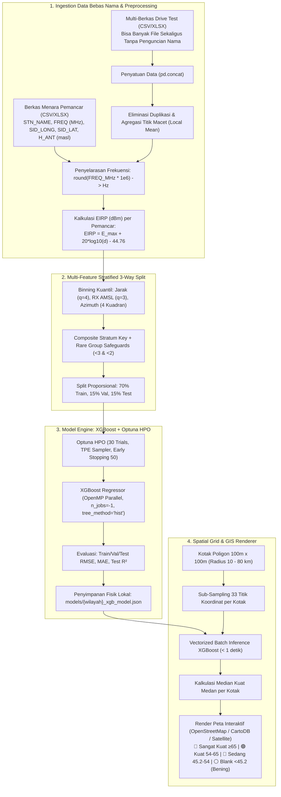

# DVB-T2 Broadcast AI Propagation & GIS Suite (Multi-Region)

Aplikasi end-to-end berbasis Python, Machine Learning (**XGBoost** & **Optuna**), dan Sistem Informasi Geografis (**Streamlit** & **Folium / Leaflet**) untuk memprediksi kuat medan sinyal (*field strength* dalam $\text{dB}\mu\text{V/m}$) siaran televisi digital terestrial DVB-T2 pada kanal UHF (Band IV/V), serta memetakan area jangkauan hingga ke wilayah *blank spot* yang tidak terjangkau pengukuran darat.

---

## 🏛️ Arsitektur Lengkap Sistem



---

## 🔬 Matriks Data & 8 Fitur Fisik Model AI

| Kategori | Nama Fitur | Tipe Data | Deskripsi & Justifikasi Fisik |
|---|---|---|---|
| **Fitur 1** | `frequency_hz` | Integer ($\text{Hz}$) | Frekuensi kerja siaran TV digital UHF (dikonversi dari $\text{MHz} \times 10^6$). |
| **Fitur 2** | `eirp_dbm` | Float ($\text{dBm}$) | Daya pancar isotropis efektif empiris: $\text{EIRP} = E_{\max} + 20\log_{10}(d_{\text{km}}) - 44{,}76$. |
| **Fitur 3** | `distance_km` | Float ($\text{km}$) | Jarak geodetik Haversine menara ke penerima (dijaga $d \neq 0$). |
| **Fitur 4** | `azimuth_sin` | Float $[-1, 1]$ | $\sin(\theta_{\text{bearing}})$ mengeliminasi diskontinuitas sudut batas utara ($0^\circ \leftrightarrow 360^\circ$). |
| **Fitur 5** | `azimuth_cos` | Float $[-1, 1]$ | $\cos(\theta_{\text{bearing}})$ berpasangan dengan sinus untuk keunikan 4 kuadran. |
| **Fitur 6** | `tx_antenna_amsl`| Float (meter) | Ketinggian antena pemancar di atas permukaan laut (`H_ANT (masl)`). |
| **Fitur 7** | `rx_antenna_amsl`| Float (meter) | Ketinggian antena penerima di atas permukaan laut (`Altitude (m)`). |
| **Fitur 8** | `clearance_m` | Float (meter) | Jarak bebas garis pandang (*clearance*) terhadap puncak bukit penghalang tertinggi di sepanjang lintasan ($h_{\text{los}} - h_{\max}$). Nilai $<0$ menandakan kondisi terhalang (*Non-Line-of-Sight* / NLoS). |
| **Target ($y$)**| `field_strength_dbuv_m` | Float ($\text{dB}\mu\text{V/m}$) | Kuat medan sinyal riil dari instrumen pemindai (*Level*). |
| **Metadata** | `STN_NAME, SID_LAT, SID_LONG, Latitude, Longitude` | Teks / Derajat | **Diisolasi dari Model:** Hanya untuk plotting GIS guna mencegah *spatial overfitting*. |

---

## 📶 Standar Kategori Kuat Medan DVB-T2 (Band IV/V UHF)

Sesuai standar teknis ITU-R BT.1368 / BT.2033 dan Permenkominfo untuk penerimaan DVB-T2 kanal UHF:

* 🔴 **Sangat Kuat ($\ge 65{,}0\text{ dB}\mu\text{V/m}$):** Area dekat pemancar (*Line-of-Sight*), sinyal sangat dominan.
* 🟢 **Kuat ($54{,}0\text{ s/d } 65{,}0\text{ dB}\mu\text{V/m}$):** Penerimaan portabel dalam ruangan (*indoor*) sangat baik dan bebas *glitch*.
* 🔵 **Sedang ($45{,}2\text{ s/d } 54{,}0\text{ dB}\mu\text{V/m}$):** Memenuhi standar batas minimum penerimaan luar ruangan (*fixed outdoor rooftop antenna*).
* ⚪ **Blank Spot ($< 45{,}2\text{ dB}\mu\text{V/m}$):** **Transparan / Tanpa Warna.** Di bawah sensitivitas minimum demodulator DVB-T2 (QEF failure). Peta jalan/lingkungan di bawahnya terlihat jelas.

---

## 🚀 Panduan Menjalankan Aplikasi

### 1. Masuk ke Direktori Proyek
```powershell
cd C:\Users\user\.gemini\antigravity\scratch\dvbt2-propagation-ai
```

### 2. Jalankan Dashboard Web Streamlit
```powershell
streamlit run app.py
```
Aplikasi akan terbuka otomatis di browser pada: `http://localhost:8501`.

---

## 🖥️ Panduan Operasional di Dashboard

1. **Tab 1: Ingestion Data & Peta Spasial Awal**
   * Di panel samping (sidebar), unggah berkas pemancar dan multi-file *drive test* (atau klik tombol *"💡 Muat Data Sampel Bawaan"* untuk uji coba instan Balikpapan).
   * Klik tombol **"🚀 Proses & Bersihkan Data"**.
   * Amati tabel pemancar dengan nilai **`EIRP (dBm)`** terhitung, ringkasan baris data bersih, serta peta sebaran menara dan rute mobil ukur.
2. **Tab 2: Stratified Split & Pelatihan AI (XGBoost)**
   * Klik tombol **"📊 Jalankan Multi-Feature Stratified Split (70:15:15)"**.
   * Periksa tabel *sanity check* statistik lengkap (rata-rata & median clearance, rasio LoS/NLoS) dan visualisasi komparatif 8 panel distribusi fitur.
   * Klik tombol **"⚡ Mulai Optimasi & Pelatihan XGBoost"** (menjalankan optimasi Optuna secara lokal).
   * Amati tabel metrik evaluasi akhir (Train/Val/Test RMSE, MAE, $R^2$), Parity Plot, dan Feature Importance.
3. **Tab 3: Peta Cakupan Kotak Grid (Coverage Map)**
   * Pilih stasiun pemancar yang ingin dianalisis (misal: *TRANS TV Balikpapan*).
   * Atur filter radius ($10 - 80\text{ km}$), resolusi kotak grid ($100\text{ m}, 200\text{ m}, 500\text{ m}$), dan saklar **Strict NLoS Cutoff** di sidebar.
   * Klik tombol **"🎨 Bangkitkan Peta Coverage Kotak"**.
   * Amati peta interaktif: kotak-kotak poligon (median 33 titik) terhampar dengan warna Merah, Hijau Muda, Biru Muda, dan area Blank Spot transparan tembus pandang ke peta dasar jalan/satelit.
   * Unduh hasil grid lengkap atau daftar titik blank spot melalui tombol CSV.
4. **Tab 4: Kalkulator Prediksi Titik Tunggal**
   * Masukkan koordinat Latitude, Longitude, dan tinggi antena penerima.
   * Dapatkan estimasi kuat medan ($\text{dB}\mu\text{V/m}$), status kategori, jarak, sudut arah antena, profil clearance medan, dan batas radio horizon.

---

## 🤝 Kolaborasi Tim Menggunakan Google Antigravity

Repository ini telah dikonfigurasi penuh agar rekan tim dapat langsung membuka dan melanjutkan pengembangannya menggunakan **Google Antigravity**:

1. **Bagikan Folder Proyek:**
   * **Via Git (GitHub/GitLab) [Direkomendasikan]:** Dorong (*push*) folder ini ke repositori Git tim, lalu rekan tim melakukan `git clone`.
   * **Via Arsip ZIP:** Kompres seluruh folder `dvbt2-propagation-ai` dan bagikan ke rekan tim.
2. **Buka di Antigravity:**
   * Rekan tim cukup membuka Google Antigravity (IDE atau Desktop App) dan memilih folder `dvbt2-propagation-ai` sebagai **Active Workspace**.
3. **Konteks Otomatis (`GEMINI.md`):**
   * Antigravity di komputer rekan tim akan langsung membaca file [`GEMINI.md`](./GEMINI.md) di *root directory*. Agen Antigravity mereka akan otomatis memahami arsitektur 8 fitur, modul-modul di `src/`, aturan pengkodean, serta cara menjalankan dan menguji aplikasi tanpa perlu diberi penjelasan manual dari awal.
4. **Instalasi Dependensi:**
   ```powershell
   pip install -r requirements.txt
   ```
5. **Jalankan Aplikasi / Verifikasi:**
   * Jalankan aplikasi: `.\run_app.bat` atau `python -m streamlit run app.py`
   * Jalankan pengujian otomatis: `python test_pipeline.py`
